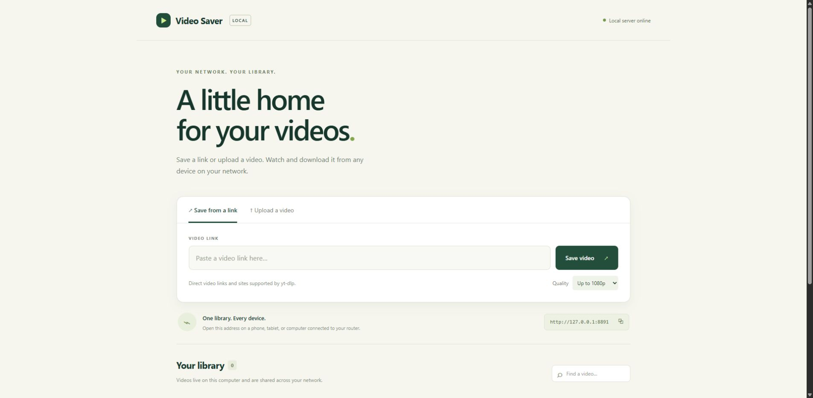

<div align="center">

# Video Saver

**A home for your videos. On your computer. Across your Wi-Fi.**

Save video links, upload files, and watch or download from a browser on your local network.




</div>

One computer runs the app. Your phone, tablet, and other computers open its network link in a browser. Videos stay on the host computer. No account, subscription, or cloud storage service is required.

## Features

- Save direct video links and links supported by [yt-dlp](https://github.com/yt-dlp/yt-dlp).
- Upload videos from your computer or phone; drag and drop works on desktop.
- Watch, seek, search, or download videos from a shared library.
- Choose up to 720p, up to 1080p, or the best available source quality.
- Upload files up to 8 GB each, with progress indicators.
- Run two link downloads at a time, with up to 20 active/queued link requests.
- Keep your library after restarting the app.
- Use a responsive interface with no frontend build step.

## Download

Choose **Code → Download ZIP** on this repository, then extract the ZIP to a folder you own. **Extract it before running anything.** You can also clone the repository with Git.

The download contains the app's source code. Python, yt-dlp, FFmpeg, and JavaScript runtimes are separate third-party tools; their licenses apply independently. Your own video library is created when you start the app.

## Requirements

Install these on the **host computer only**. Other devices just need a modern browser.

| Tool | What it is for |
| --- | --- |
| [Python 3.11+](https://www.python.org/downloads/) | Runs the web app and local setup |
| [FFmpeg](https://ffmpeg.org/download.html) | Merges audio/video tracks and prepares downloaded video files |
| [yt-dlp](https://github.com/yt-dlp/yt-dlp) | Saves video links; installed by the setup helper |
| [Node.js](https://nodejs.org/) or [Deno](https://deno.com/) | Some video sites require a supported JavaScript runtime; see [yt-dlp's current runtime requirements](https://github.com/yt-dlp/yt-dlp/wiki/EJS) |

Uploads and local playback do not need yt-dlp or FFmpeg. Link saving needs internet access on the host. Browser playback depends on the video's codecs; download incompatible files and open them in a suitable video player.

## Windows quick start

1. Install Python 3.11 or newer from [python.org](https://www.python.org/downloads/). Enable **Add Python to PATH** if the installer offers it.
2. Install FFmpeg and, for broader site support, a supported JavaScript runtime. If you use Windows Package Manager, run these in a terminal:

   ```powershell
   winget install --id Gyan.FFmpeg --exact
   winget install --id OpenJS.NodeJS.LTS --exact
   ```

   Close and reopen your terminal after installation so it sees the updated PATH. Manual FFmpeg downloads are linked from [ffmpeg.org](https://ffmpeg.org/download.html); add its `bin` folder to PATH.

3. Double-click **Setup.cmd**. It creates a `.venv` folder and installs yt-dlp and its default extras there. It does not install packages into your system Python.
4. Double-click **Start.cmd**. The app runs in the background, and the window prints your network link.
5. On this computer, open **http://127.0.0.1:8787**. On another device, open the **Network link** printed by the launcher.
6. Double-click **Stop.cmd** when you want to stop sharing. Your videos remain saved.

If Windows Firewall blocks other devices, run **Allow-network.cmd** and approve the administrator prompt. It permits the app's local Python environment on TCP port 8787 from local subnets. It does not change your router or enable internet access to the app.

The app does **not** start automatically after reboot. Run **Start.cmd** again to bring the library online.

## macOS and Linux

Install Python 3.11+, FFmpeg, and a supported JavaScript runtime through your usual package manager or their official installers. On Debian/Ubuntu, the Python `venv` component may be a separate system package.

In the extracted project folder:

```sh
python3 setup_local.py
sh start.sh
```

Open **http://127.0.0.1:8787** or the printed network link. Leave the terminal running; press **Ctrl+C** to stop. Allow incoming TCP traffic on port 8787 from your local subnet if your host firewall blocks it. The Windows `.cmd` and `.ps1` helpers are for Windows only.

The current release has been checked on Windows. macOS/Linux launch commands and portable integration tests are included; local validation on those operating systems is welcome.

## Use it from your phone or another device

1. Keep the host computer powered on and awake, with Video Saver running.
2. Connect both devices to the same router/network. The host can use Ethernet while your phone uses Wi-Fi.
3. Open the host's printed **Network link** in the other device's browser. Use the full `http://` address and include `:8787`.
4. Save a link or upload a video, then choose **Watch** or **Download**.

`127.0.0.1` and `localhost` always refer to the device you are using; they are only useful on the host. Use the printed network address on your phone. The address may change after a router or computer restart. The launcher always prints the current address; a DHCP reservation in your router can make it stable.

## Your data and privacy

- Videos are saved in `library/` and history is kept in `library.sqlite3`, beside the app by default.
- No analytics, tracking scripts, or external frontend resources are built into the app.
- Saving an internet video contacts its source website through yt-dlp. Setup and updates contact the package index. Links you choose to visit in this README contact their respective sites.
- **Everyone who can access the network link shares the same library. There are no user accounts or passwords.** Use it on a trusted local network.
- The Git ignore rules exclude libraries, databases, logs, runtime records, virtual environments, and environment files. Review your files before sharing a modified copy.
- Back up `library/` and `library.sqlite3` together while the app is stopped. Do not put either in GitHub.

This is a local-network tool. It is not designed for public internet hosting: do not port-forward it or expose it through a public tunnel.

## Useful commands

Use `.venv\Scripts\python.exe` on Windows or `.venv/bin/python` on macOS/Linux after setup.

```sh
# Example on macOS/Linux: a different port
.venv/bin/python server.py --port 8788

# Only this computer; do not share over the network
.venv/bin/python server.py --local-only

# Update the download engine and its default extras
.venv/bin/python -m pip install --upgrade "yt-dlp[default]"

# Run the offline integration tests (no third-party packages required)
python3 -m unittest discover -s tests -v
```

For a different Windows port, use `powershell -NoProfile -ExecutionPolicy Bypass -File .\Start.ps1 -Port 8788`. The supplied firewall helper allows the default port only; a custom port needs a matching firewall rule.

To store runtime data elsewhere, set the `VIDEO_SAVER_DATA_DIR` environment variable to a directory you own before starting the server. Back up that location instead of the default folders.

## Troubleshooting

| Problem | Try this |
| --- | --- |
| Connection refused | Start the app, check the host is awake, and use the latest network link. |
| Works on the host but not on my phone | Use the same router, avoid guest Wi-Fi/client isolation, check the host firewall and VPN settings, and include the port. |
| Multiple network links | Use the one associated with your router; virtual adapters or VPNs may add others. |
| Python is missing | Install Python 3.11+, reopen the terminal, and run Setup.cmd again. |
| yt-dlp is missing | Run Setup.cmd or `python3 setup_local.py`, then restart the app. |
| Download fails or a site stops working | Update yt-dlp, verify FFmpeg/runtime installation, and try a fresh direct link. Sites may restrict automated downloads or require login. |
| A video will not play | Download it and open it in a player that supports its codecs. Remuxing to MP4 does not convert codecs. |
| Quality is not exactly 1080p | The selector sets a maximum where resolution metadata exists; it does not upscale. Some direct links have unknown resolution. |
| A transfer was interrupted | Submit it again. The app keeps finished videos, but does not resume interrupted jobs after a restart. |
| Disk space is low | Stop the app and back up/move the library, or remove unwanted video files. There is no in-app delete feature in this release. |
| A port is already in use | Stop the other copy or select another port. |

Windows launch diagnostics are in `server.log` and `server-error.log`. After moving the app folder or recreating `.venv`, rerun Allow-network.cmd if needed so the firewall rule matches the new Python location. Remove the optional firewall rule from an administrator PowerShell with `Remove-NetFirewallRule -Name LocalVideoSaver8787`.

## Limits

- Single videos only; playlists are disabled.
- Link downloads have an 8 GB yt-dlp size filter and a one-hour timeout. Some sources cannot report their final size in advance; this is not a hard disk quota. Uploads have a strict 8 GB request limit.
- The app does not import browser cookies, bypass DRM, or promise support for every site.
- Share only videos you have permission to save and redistribute, and follow the source site's rules.

## Contributing

Bug reports and pull requests are welcome. See [CONTRIBUTING.md](CONTRIBUTING.md) for local development and reporting guidance, and [SECURITY.md](SECURITY.md) for the supported security model.

## License and credits

Video Saver is available under the [MIT License](LICENSE). Thanks to [yt-dlp](https://github.com/yt-dlp/yt-dlp), [FFmpeg](https://ffmpeg.org/), and [Python](https://www.python.org/). These dependencies are installed separately and retain their own licenses. See [THIRD_PARTY_NOTICES.md](THIRD_PARTY_NOTICES.md).
